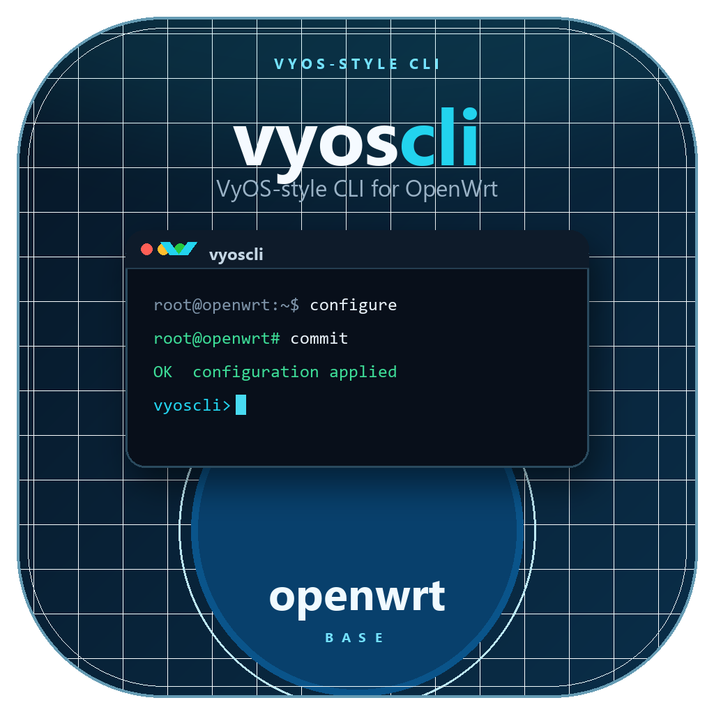

# vyoscli — 类 VyOS 的 OpenWrt CLI

<p align="center">
  
</p>

> **本项目由 DeepSeek Harness 协助完成。**

用 Python 实现的 VyOS 风格命令行，以 opkg 包安装到 OpenWrt。
保留 VyOS 的核心交互模型：**操作模式 / 配置模式**分离、
**candidate → commit → running** 事务、`commit confirmed` 自动回滚、
Tab/`?` 补全、`show` 分页、配置快照与漂移检测。

命令树对齐 **VyOS 1.5** 的主要结构：`interfaces`、`policy`、
`protocols bgp <asn>`、`protocols bfd`、`service dhcp-server`、
`container name/network` 等。纯 Python，不依赖 UCI 之外的框架；
没有 UCI 对应项时才退化为 `ip`/`nft`/`tc`/FRR 等原生命令。

**当前版本：0.2.0**（变更见 [CHANGELOG.md](CHANGELOG.md)）。

- 完整命令参考：[docs/COMMANDS.md](docs/COMMANDS.md)（593 条，自动生成）
- 操作/配置指南：[docs/GUIDE.md](docs/GUIDE.md)
- DHCP 测试模板：[docs/DHCP-TEST.md](docs/DHCP-TEST.md)
- 功能差距与测试记录：[docs/AUDIT.md](docs/AUDIT.md)、[docs/VYOS-GAP.md](docs/VYOS-GAP.md)

---

## 特性

| 能力 | 说明 |
|---|---|
| 双模式 CLI | `root@host:~$` 操作模式 / `root@host#` 配置模式，`run` 可在配置模式跑 op 命令 |
| candidate 事务 | `set/delete` 只改 candidate，`commit` 才生效并写盘 |
| 安全提交 | `commit confirmed N` 超时自动回滚，`commit confirm` 取消定时器 |
| 快照/回滚 | 每次 commit 前保存快照（保留 20 个），`rollback [ts]` |
| 漂移检测 | `show system drift` 对比提交指纹与当前 UCI |
| 开机对账 | `init.d/vyoscli` 后台执行 `vyoscli --sync`，只重放漂移段 |
| VyOS 补全 | Tab / `?` 输出 `Possible completions:` + 两列对齐；支持 `run show ...` |
| 分页 | 所有 `show` 输出支持空格下一页、`b` 上一页、`q` 退出 |
| 原生后端 | UCI/netifd、fw4/nftables、FRR、dnsmasq、podman、strongSwan、xl2tpd 等 |
| 真机验证 | 关键功能均有设备测试记录，详见 AUDIT.md |

---

## 目录结构

```
package/vyoscli/
├── Makefile                      # OpenWrt 包定义（opkg）
├── files/
│   ├── usr/bin/vyoscli           # 启动器
│   ├── usr/lib/vyoscli/          # Python 包
│   │   ├── cli.py                # REPL、双模式、补全、分页、帮助
│   │   ├── tree.py               # 命令树、动态节点、值校验
│   │   ├── commands.py           # op 命令注册
│   │   ├── schema.py             # 声明式 Spec + 树构建
│   │   ├── config_tree.py        # 生成的配置树数据
│   │   ├── config.py             # 事务、UCI/nft/FRR/podman 下发
│   │   ├── op_show.py            # show/ping/mtr 等实现
│   │   └── __main__.py           # 入口、回滚定时器、boot sync
│   └── etc/init.d/vyoscli        # 开机对账
schema/config-tree.json           # 唯一手改的命令树源
scripts/                          # 打包、生成、校验脚本
tests/                            # unittest
docs/                             # 命令参考、指南、审计、依赖
```

---

## 编译与安装

### 方式一：OpenWrt SDK（推荐发布）

```bash
wget https://downloads.openwrt.org/releases/24.10.0/targets/x86/64/openwrt-sdk-24.10.0-x86-64_gcc-13.3.0_musl.Linux-x86_64.tar.zst
tar -I zstd -xvf openwrt-sdk-24.10.0-*.tar.zst

SDK=~/openwrt-sdk-24.10.0-x86-64_gcc-13.3.0_musl.Linux-x86_64 \
  ./scripts/build-ipk.sh

scp bin/packages/*/base/vyoscli_*.ipk root@router:/tmp/
ssh root@router 'opkg install /tmp/vyoscli_*.ipk'
```

手工编译：

```bash
cd openwrt-sdk-*/
mkdir -p package/utils && cp -r /path/to/repo/package/vyoscli package/utils/
make defconfig
sed -i 's/^# CONFIG_PACKAGE_vyoscli is not set/CONFIG_PACKAGE_vyoscli=y/' .config
make defconfig && make package/utils/vyoscli/compile V=s
find bin/packages -name 'vyoscli*.ipk'
```

### 方式二：无 SDK 快速打包（设备测试）

```bash
python3 scripts/make-ipk.py --minimal-deps   # dist/vyoscli_0.1.0-r1_all.ipk
python3 scripts/make-ipk.py                  # 带完整 Depends
```

`--minimal-deps` 只声明 `libc/python3/python3-readline/ip-full`，
适合在没装齐可选包的路由器上冒烟；正式发布建议 SDK。

### 依赖

完整依赖见 [docs/DEPENDENCIES.md](docs/DEPENDENCIES.md)。按功能分组：

| 功能 | 依赖 |
|---|---|
| CLI | python3、python3-readline、ip-full |
| BGP/OSPF/RIP/BFD | frr、frr-ospfd、frr-ripd、frr-bfdd |
| DHCP/DNS | dnsmasq、smartdns、adguardhome |
| 防火墙/NAT | fw4、nftables、iptables-nft、kmod-ipt-* |
| WireGuard | kmod-wireguard、wireguard-tools |
| OpenVPN | openvpn-openssl |
| IPsec | strongswan、strongswan-ipsec、strongswan-charon、插件 |
| L2TP | xl2tpd、ppp-mod-pppol2tp |
| 容器 | podman、netavark、iptables/conntrack 模块 |
| LLDP | lldpd |
| 用户管理 | shadow-useradd、shadow-chpasswd |
| 路径监测 | mtr、mtr-json |

小闪存设备可删掉 `Makefile` 中 `DEPENDS` 用不到的行；缺包时对应功能输出
`... apply failed`，其余配置不受影响。

依赖处理策略：

- **核心包**只依赖 `python3/python3-readline/ip-full`；
- 其他功能按需安装，`show dependencies [feature]` 按功能列出 OK/MISSING 和安装命令；
- 不自动安装依赖（避免 commit 时做网络 IO，尤其在改 WAN 时）；
- 可选 `vyoscli-full` meta 包一次装齐，详见
  [docs/DEPENDENCIES.md](docs/DEPENDENCIES.md)。

---

## 快速开始

```bash
root@OpenWrt:~# vyoscli
Welcome to vyoscli (a VyOS-style CLI for OpenWrt).

root@OpenWrt:~$ configure
root@OpenWrt# set system host-name edge-router
root@OpenWrt# set interfaces ethernet eth0 address 192.168.1.1/24
root@OpenWrt# set service dhcp-server shared-network-name LAN interface lan
root@OpenWrt# set service dhcp-server shared-network-name LAN subnet 192.168.1.0/24 default-router 192.168.1.1
root@OpenWrt# compare
root@OpenWrt# commit
root@OpenWrt# exit
```

远程改 SSH/防火墙/NAT 等敏感配置时用两段式提交：

```bash
root@OpenWrt# commit confirmed 5     # 5 分钟不确认自动回滚
root@OpenWrt# commit confirm         # 确认正常，取消定时器
```

### Tab 与 `?`

```bash
root@OpenWrt# set 
Possible completions:
  container          Podman containers
  firewall           Firewall policy
  interfaces         Interface parameters
  nat                Network Address Translation
  policy             Routing policy
  protocols          Routing protocols
  service            System services
  system             System parameters
  vpn                VPN
```

```bash
root@OpenWrt# set interfaces ethernet eth0 ?
Possible completions:
  address     IPv4 address/prefix
  description Description
  mtu         MTU (default 1500)
  vif         VLAN interface
  ...
```

输出较长时自动进入分页：空格下一页、`b` 上一页、`q` 退出。

---

## 操作模型

| 命令 | 作用 |
|---|---|
| `configure` | 进入配置模式 |
| `set <path> <value>` | 写入 candidate |
| `delete <path> [value]` | 删除节点或列表项 |
| `edit <path>` / `next <path>` | 进入子节点，提示符显示 `[path]` |
| `up` | 返回上一层 |
| `show configuration` | 查看 candidate |
| `show configuration commands` | 导出为 `set` 命令 |
| `show configuration json` | 导出 JSON |
| `compare` | running vs candidate |
| `commit` | 应用并写盘 |
| `commit confirmed [N]` | 应用并挂 N 分钟回滚（默认 5） |
| `commit confirm` | 取消回滚定时器 |
| `discard` | 丢弃 candidate |
| `save` | 立即持久化 running |
| `sync` | 只重放漂移的段落 |
| `rollback [timestamp]` | 回滚快照 |
| `run <op command>` | 配置模式执行 op 命令 |

存储位置：

| 路径 | 内容 |
|---|---|
| `/etc/vyoscli/running.json` | 当前生效配置 |
| `/etc/vyoscli/candidate.json` | 未提交修改 |
| `/etc/vyoscli/applied.json` | 已提交 UCI 指纹 |
| `/etc/vyoscli/history/<ts>.json` | commit 前快照（20 个） |
| `/etc/vyoscli/backup/` | 接管已有接口/UCI 段前的备份 |
| `/etc/vyoscli/rollback.conf` | confirmed-commit 定时器 |

配置为 `0600`（含 WireGuard 私钥、PSK、密码等）。

---

## 配置示例

### 系统

```bash
set system host-name r1
set system timezone Asia/Shanghai
set system name-server 223.5.5.5
set system ntp ntp.aliyun.com
set system login user admin authentication plaintext-password '***'
```

### 接口：MTU / TCP MSS / VIF / 桥

```bash
set interfaces ethernet eth0 mtu 1400
set interfaces ethernet eth0 tcp-mss 1300
set interfaces ethernet eth0 vif 100 address 192.168.100.1/24

set interfaces bridge br0 member eth1
set interfaces bridge br0 member eth2
set interfaces bridge br0 address 10.0.0.1/24

set interfaces dummy dum0 address 10.10.10.1/24
```

- 删除 `mtu` 只清 UCI，不会现场改链路，避免管理口/WAN 失联。
- `tcp-mss` 通过 fw4 include（`/etc/nftables.d/20-vyos-mss.nft`）在 mangle 链生效。

### WireGuard

```bash
set interfaces wireguard wg0 address 10.99.0.1/24
set interfaces wireguard wg0 private-key '...'
set interfaces wireguard wg0 listen-port 51820
set interfaces wireguard wg0 peer 'PEER_PUBKEY' endpoint 1.2.3.4:51820
set interfaces wireguard wg0 peer 'PEER_PUBKEY' allowed-ips 10.99.0.2/32
```

安装 `kmod-wireguard`/`wireguard-tools` 后如果 netifd 不识别新 proto，
重启一次 network（`/etc/init.d/network restart`）即可。

### BGP（VyOS 1.5 ASN 实例）

```bash
set protocols bgp 65000 parameters router-id 192.168.75.241
set protocols bgp 65000 timers holdtime 15
set protocols bgp 65000 timers keepalive 5

set protocols bgp 65000 address-family ipv4-unicast maximum-paths ibgp 4
set protocols bgp 65000 address-family ipv4-unicast redistribute connected

set protocols bgp 65000 neighbor 192.168.5.2 remote-as 65002
set protocols bgp 65000 neighbor 192.168.5.2 local-as 65001
set protocols bgp 65000 neighbor 192.168.5.2 address-family ipv4-unicast route-map export med100
set protocols bgp 65000 neighbor 192.168.5.2 address-family ipv4-unicast soft-reconfiguration inbound
set protocols bgp 65000 neighbor 192.168.5.2 bfd check-control-plane-failure

set protocols bfd peer 192.168.5.2 echo-mode
```

生成 FRR 配置：

```
router bgp 65000
 timers bgp 5 15
 neighbor 192.168.5.2 remote-as 65002
 neighbor 192.168.5.2 route-map med100 out
 neighbor 192.168.5.2 local-as 65001
 neighbor 192.168.5.2 bfd
  neighbor 192.168.5.2 activate
  neighbor 192.168.5.2 soft-reconfiguration inbound
  maximum-paths ibgp 4
  redistribute connected
bfd
 peer 192.168.5.2
  echo-mode
```

> FRR 每次 BGP 配置提交后会重启以加载 `frr.conf`；切换期间邻居会短暂重建。

### MED 三网优先级

```bash
set policy route-map med100 rule 10 action permit
set policy route-map med100 rule 10 set metric 100

set policy route-map med200 rule 10 action permit
set policy route-map med200 rule 10 set metric 200

# 无线/电台网 -> MED 100，卫星网 -> MED 200
set protocols bgp 65000 neighbor 192.168.4.2 address-family ipv4-unicast route-map export med100
set protocols bgp 65000 neighbor 192.168.75.218 address-family ipv4-unicast route-map export med200
```

MED 数值小优先：eth5(0) → eth4(100) → eth0(200)。

### 静态路由 / Failover / OSPF / RIP

```bash
set protocols static route 10.0.0.0/8 next-hop 192.168.1.1
set protocols static table 110 route 0.0.0.0/0 next-hop 192.168.1.1

# 带健康检查的 failover 路由（检查失败约 5 秒内撤路由）
set protocols failover route 1.1.1.1/32 next-hop 192.168.75.1 check target 223.5.5.5
set protocols failover route 1.1.1.1/32 next-hop 192.168.75.1 check interface eth1
set protocols failover route 1.1.1.1/32 next-hop 192.168.75.1 metric 10

set protocols ospf router-id 192.168.1.1
set protocols ospf area 0 network 192.168.1.0/24

set protocols rip version 2
set protocols rip network 192.168.1.0/24
```

> 当前 CLI 的叶子值后不能继续接子路径；`check target`、`check interface`
> 请分两条 `set`。failover 监控脚本在 `/etc/vyoscli/failover/monitor.py`，
> 每 5 秒检测一次，多个 next-hop 按 metric 从小到大选择。

### Policy：route-map / community-list / local-route

```bash
set policy community-list 80 rule 10 action permit
set policy community-list 80 rule 10 regex '65000:9939'

set policy route-map RM rule 100 action permit
set policy route-map RM rule 100 description to_hk
set policy route-map RM rule 100 match community community-list 80
set policy route-map RM rule 100 set ip-next-hop 10.10.57.1
set policy route-map RM rule 100 set local-preference 50

set policy local-route rule 6600 source 192.168.1.1
set policy local-route rule 6600 set table 110
```

### 防火墙 / NAT

```bash
# VyOS 风格规则（inet vyos_fw, priority -10）
set firewall ipv4 input filter rule 100 action accept
set firewall ipv4 input filter rule 100 protocol tcp
set firewall ipv4 input filter rule 100 destination port 8080

# 地址/端口/接口组
set firewall group address-group AG address 203.0.113.0/24
set firewall group port-group PG port 8080

# NAT
set nat source rule 100 out-interface eth0
set nat source rule 100 translation address masquerade

set nat destination rule 100 inbound-interface eth0
set nat destination rule 100 destination port 8080
set nat destination rule 100 translation address 10.0.0.10
```

### DHCP / DNS

```bash
set service dhcp-server shared-network-name LAN interface lan
set service dhcp-server shared-network-name LAN subnet 192.168.1.0/24 default-router 192.168.1.1
set service dhcp-server shared-network-name LAN subnet 192.168.1.0/24 name-server 192.168.1.1
set service dhcp-server shared-network-name LAN subnet 192.168.1.0/24 range R1 start 192.168.1.100
set service dhcp-server shared-network-name LAN subnet 192.168.1.0/24 range R1 stop 192.168.1.150

show dhcp server
show dhcp server pools
show dhcp server leases
show dhcp server static
```

完整测试步骤见 [docs/DHCP-TEST.md](docs/DHCP-TEST.md)。

### 容器（VyOS 结构）

```bash
# 虚拟网络（不存在会自动创建）
set container network vnet prefix 10.89.7.0/24
set container network vnet gateway 10.89.7.1

# host 网络
set container name c1 image docker.io/library/nginx:alpine
set container name c1 allow-host-networks

# 加入虚拟网络
set container name c2 image docker.io/library/busybox:latest
set container name c2 network vnet
set container name c2 volume conf source /config/c2 destination /app/conf
set container name c2 environment TZ value Asia/Shanghai
set container name c2 restart no
```

`container name` 还支持 `privileged`、`capability`、`device`、`port`、
`command`、`disable`；`container network` 支持 `prefix/gateway/mtu/type/description`。

### VPN

```bash
# L2TP
set vpn l2tp local-ip 10.99.9.1
set vpn l2tp pool-start 10.99.9.100
set vpn l2tp pool-end 10.99.9.150
set vpn l2tp user test password '***'

# IPsec（需要 strongswan-ipsec/charon 插件）
set vpn ipsec ike-group IKE1 proposal 10 encryption aes256
set vpn ipsec ike-group IKE1 proposal 10 hash sha256
set vpn ipsec esp-group ESP1 proposal 10 encryption aes256
set vpn ipsec esp-group ESP1 proposal 10 hash sha256

# OpenVPN
set interfaces openvpn vtun9 mode server
set interfaces openvpn vtun9 proto udp
set interfaces openvpn vtun9 port 11999
set interfaces openvpn vtun9 dev tun
```

### 服务

SSH、NTP、LLDP、SNMP、Router Advertisement、DHCP、DNS（dnsmasq/smartdns/AdGuard）、
SQM、TCP 加速、KCP、Console Server、Crontab、HTTPS API、MTR 的完整配置示例见
[GUIDE.md 服务章节](docs/GUIDE.md#11-服务)。例如 MTR：

```bash
set service mtr t1 target 1.1.1.1
set service mtr t1 interface eth1
set service mtr t1 count 10
set service mtr t1 interval 60
show service mtr
```

### 运维/诊断

```bash
show interfaces
show ip route static
show ip bgp summary
show ip bgp neighbors 192.168.5.2 received-routes
show system uptime
show system cpu
show system login user
show system connections
show system drift

ping 1.1.1.1                 # 交互式长 ping，Ctrl+C 结束
ping tcp 1.1.1.1 443         # 或 ping tcp ip 1.1.1.1 port 443
ping udp 1.1.1.1 53

show service mtr
set service mtr t1 target 1.1.1.1
set service mtr t1 count 10
set service mtr t1 interval 60
```

---

## 测试与 CI

```bash
python3 -m unittest discover -s tests -v
./scripts/check-generated.sh
python3 scripts/make-ipk.py --minimal-deps
```

CI（`.github/workflows/ci.yml`）每次 push/PR：

1. 全量单测（135 条）；
2. 校验 `config_tree.py`、`docs/COMMANDS.md` 由源生成且无差异；
3. 无 SDK 打包冒烟。

修改命令树只改 `schema/config-tree.json`，然后：

```bash
python3 scripts/build-config-tree.py
python3 scripts/gen-command-reference.py
```

---

## 已知限制

- **DHCP relay**：`dhcp-fwd` 已改为前台启动并去掉 chroot，但设备上仍会退出，
  日志 `BOOTREQUEST request from interface without clients`，暂未完全可用。
- **container 默认网络**：netavark 依赖 iptables/conntrack/addrtype 内核模块；
  缺模块时用 `container name ... network host` 或补齐依赖。
- **container 镜像拉取**：默认 registry 可能不可达；建议先 `add container image`
  或使用本地已有镜像。
- **IPsec**：已能生成 ike/esp 组和启动 strongSwan，site-to-site/证书场景未做端到端。
- **Wireless**：依赖射频硬件，未做端到端验证。
- **commit 非原子**：某段下发失败时其余段仍会执行并返回说明。
- **FRR 重启**：BGP 配置提交会重启 FRR，邻居会短暂重建。
- VyOS 风格防火墙/NAT 使用独立 nft 表，`accept` 仍会继续走 fw4 zone 策略。

更细的测试记录、修复历史与差距见 [docs/AUDIT.md](docs/AUDIT.md) 和
[docs/VYOS-GAP.md](docs/VYOS-GAP.md)。

---

## License

MIT
